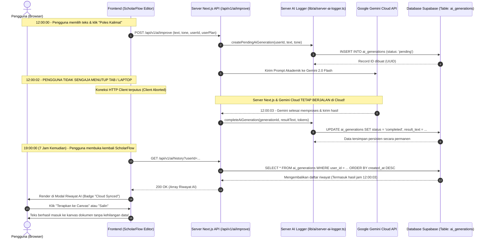

# Server-Side AI History & Resilient Background Execution (ChatGPT-Style)

## 📌 Ringkasan Arsitektur
Dokumentasi ini menjelaskan arsitektur ketahanan transaksi AI di ScholarFlow, di mana pemrosesan AI tetap diselesaikan oleh server di awan (*cloud*) dan dicatat ke database Supabase meskipun pengguna menutup browser, me-refresh tab, atau mematikan laptop di tengah-tengah proses.

---

## 🔄 Sequence Diagram: Siklus Hidup Transaksi AI (Kasus Tab Ditutup di Detik ke-2)

Diagram berikut memetakan alur ketika pengguna menekan tombol AI pada jam 12:00:00, menutup browser di jam 12:00:02 (sebelum AI selesai), dan membuka kembali aplikasi di jam 19:00:00:



---

## 🗄️ Skema Database Supabase (`public.ai_generations`)

Tabel ini menyimpan seluruh draf hasil pemrosesan AI secara persisten lintas sesi dan lintas perangkat:

```sql
CREATE TABLE IF NOT EXISTS public.ai_generations (
    id UUID PRIMARY KEY DEFAULT gen_random_uuid(),
    user_id UUID NOT NULL REFERENCES public.profiles(id) ON DELETE CASCADE,
    document_id UUID REFERENCES public.documents(id) ON DELETE SET NULL,
    feature_type TEXT NOT NULL DEFAULT 'improve', -- 'improve', 'paraphrase', 'summarize', 'abstract', 'synthesize', 'stats'
    original_text TEXT,
    result_text TEXT,
    tone TEXT DEFAULT 'academic',
    model TEXT DEFAULT 'gemini',
    tokens_consumed INTEGER DEFAULT 0,
    status TEXT NOT NULL DEFAULT 'completed', -- 'pending', 'completed', 'failed'
    error_message TEXT,
    metadata JSONB DEFAULT '{}'::jsonb,
    created_at TIMESTAMPTZ DEFAULT NOW(),
    updated_at TIMESTAMPTZ DEFAULT NOW()
);

-- Indexing
CREATE INDEX IF NOT EXISTS idx_ai_generations_user_chronology 
    ON public.ai_generations(user_id, created_at DESC);

CREATE INDEX IF NOT EXISTS idx_ai_generations_status 
    ON public.ai_generations(status);
```

---

## 🛡️ Kebijakan Row Level Security (RLS)

Keamanan data diproteksi ketat menggunakan RLS PostgreSQL:
1. **SELECT**: `auth.uid() = user_id` (Pengguna hanya bisa melihat riwayat miliknya).
2. **INSERT**: `auth.uid() = user_id` (Pengguna hanya bisa menambahkan riwayat atas akunnya).
3. **DELETE**: `auth.uid() = user_id` (Pengguna hanya bisa menghapus riwayat miliknya).
4. **Service Role**: Backend Next.js menggunakan `supabaseAdmin` (`process.env.SUPABASE_SERVICE_KEY`) untuk memperbarui status pekerjaan di latar belakang.

---

## 🚀 Keunggulan Arsitektur Ini:
1. **Zero Data Loss**: Pengguna tidak perlu khawatir jika laptop kehabisan baterai atau koneksi terputus saat AI berpikir.
2. **Multi-Device Synchronization**: Draf polesan AI yang dibuat di laptop kampus dapat langsung dibuka dan disalin dari smartphone atau komputer rumah.
3. **Optimized Token Spending**: Token yang sudah dipotong dari akun pengguna selalu membuahkan hasil draf yang dapat diambil kapan saja.
