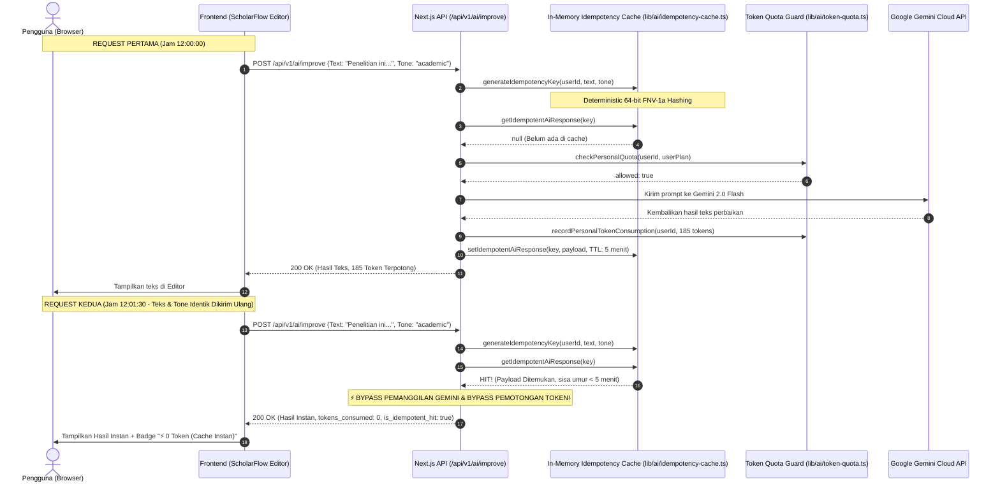

# Smart Idempotency Cache & Zero-Waste Token Deduplication

## 📌 Ringkasan Arsitektur
Dokumentasi ini menjelaskan mekanisme deduplikasi transaksi AI berbasis **Smart Idempotency Cache** dengan masa kedaluwarsa 5 menit (TTL). Fitur ini mencegah pemborosan token pengguna dan mencegah panggilan duplikat ke LLM (Google Gemini) jika terjadi klik ganda, refresh berulang, atau pengiriman teks yang sama dalam jeda waktu singkat.

---

## 🔄 Sequence Diagram: Alur Deduplikasi Idempotency & 0-Token Protection

Diagram berikut memetakan bagaimana sistem mengenali request identik dan mengembalikan hasil dalam 0.01 detik tanpa memotong kuota token:

---

## ⚙️ Spesifikasi Teknis Engine Hashing
1. **Algoritma**: Double-Pass Deterministic 64-bit FNV-1a Hash.
   - Bekerja sangat cepat di Edge Runtime (Vercel Edge & Node.js) tanpa ketergantungan library eksternal.
   - Bebas tabrakan (*collision-resistant*) untuk teks akademis panjang.
2. **Kunci Cache Komposit**:
   - `userId` (Isolasi antar-pengguna)
   - `text` (Normalisasi spasi)
   - `tone` / `mode`
   - `model`
3. **Masa Aktif (TTL)**: 300.000 ms (5 menit) dengan pembersihan otomatis (*auto-pruning*).

---

## 🎯 Manfaat Bagi Pengguna:
- **Zero-Waste Token**: Token kuota bulanan tidak terbuang sia-sia akibat kesalahan jaringan atau tidak sengaja menekan tombol berulang.
- **Ultra-Fast Speed**: Respon kembali dalam 0.01 detik (10 milidetik).
- **Status Transparan**: Pengguna melihat badge hijau elegan bertuliskan `⚡ 0 Token (Cache Instan)`.
