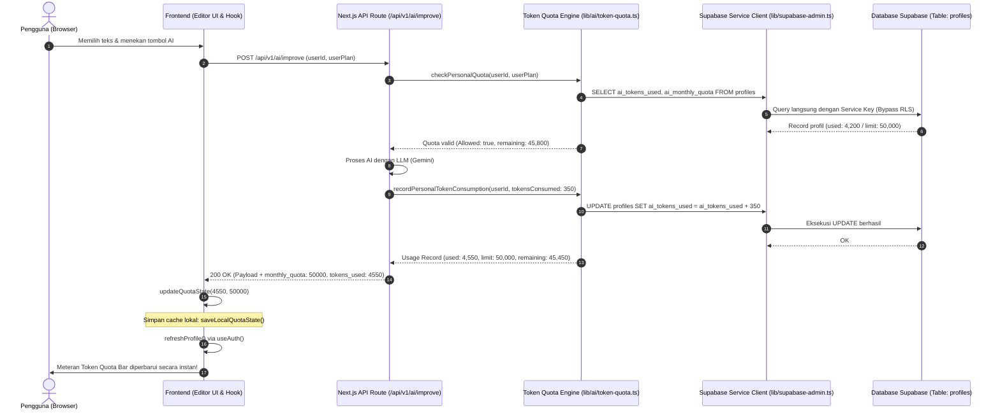

# Personal AI Token Quota & Service-Role Quota Tracking

## 📌 Ringkasan Arsitektur
Dokumentasi ini menjelaskan mekanisme pelacakan kuota token AI pengguna (*Personal Fair Usage Policy*), siklus reset 30 hari, dan pembaruan database berhak penuh (*service-role bypass*) untuk mencegah kegagalan pemotongan kuota akibat Row Level Security (RLS).

---

## 🔄 Sequence Diagram: Alur Pelacakan Kuota & Sinkronisasi Reaktif

Diagram berikut menunjukkan bagaimana backend memotong kuota pengguna secara persisten di Supabase dan menyinkronkan saldo token ke antarmuka editor secara real-time:

---

## 🎚️ Alokasi Kuota Paket & Kebijakan Reset:
1. **Paket Free**: 50.000 token per 30 hari.
2. **Paket Pro**: 1.000.000 token per 30 hari.
3. **Paket Kampus (Institutional)**: Kuota terkustomisasi per anggota (dapat disetel oleh Campus Admin).
4. **Siklus Reset**: Otomatis reset setiap 30 hari dari tanggal pendaftaran (`ai_quota_reset_at`).
