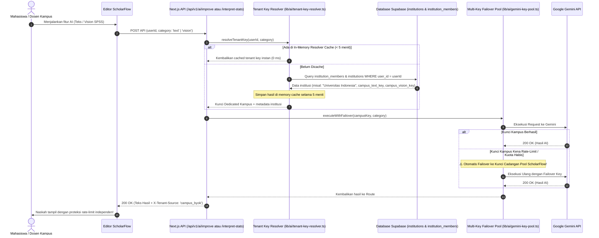

# Multi-Tenant Campus Dedicated AI Key Resolver

## 📌 Ringkasan Arsitektur
Dokumentasi ini menjelaskan sistem isolasi rate-limit API Key kampus (*Bring-Your-Own-Key* / BYOK Institusi). Sistem ini membedakan beban kerja teks akademis (`campus_text_key`) dengan beban kerja analitik vision SPSS (`campus_vision_key`), dilengkapi dengan in-memory resolver cache (5 menit) dan failover pool otomatis.

---

## 🔄 Sequence Diagram: Resolusi Kunci API Kampus & Failover

Diagram berikut menunjukkan bagaimana sistem mengidentifikasi institusi pengguna dan mengarahkan panggilan AI ke kunci dedicated kampus yang tepat:

---

## 🏛️ Manfaat Isolasi Kunci Kampus:
1. **Tidak Ada Antrean / Tabrakan Kuota**: Kuota AI mahasiswa kampus tidak akan pernah terganggu oleh lonjakan pengguna umum di internet.
2. **Dedicated Vision Key**: Pemrosesan gambar tabel SPSS berukuran besar diarahkan ke kunci terpisah (`campus_vision_key`) sehingga tidak menghabiskan kuota pemrosesan teks naskah harian (`campus_text_key`).
3. **Failover Safety Net**: Jika kunci kampus bermasalah atau kehabisan kredit di Google Cloud, sistem secara cerdas beralih ke pool cadangan ScholarFlow agar aktivitas penulisan skripsi mahasiswa tidak terhenti mendadak.
